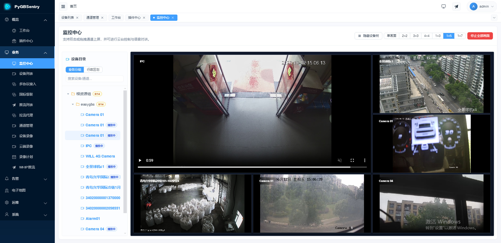
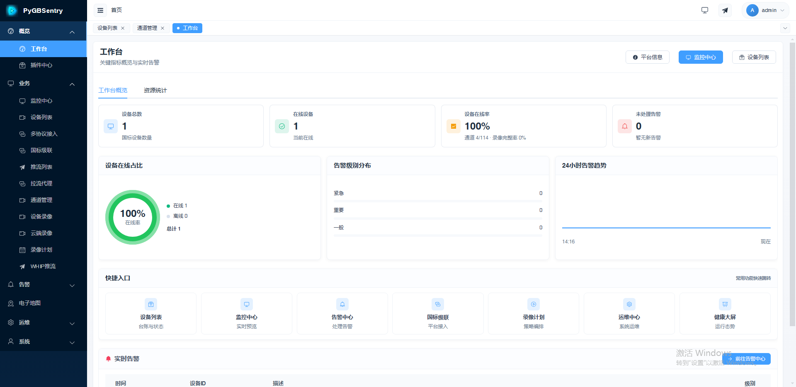
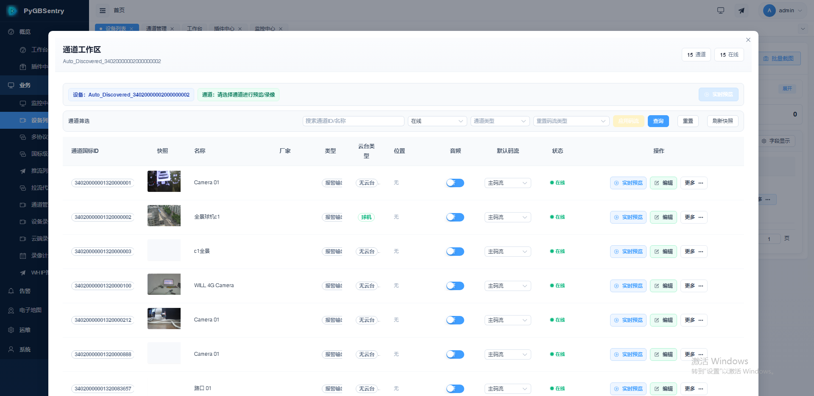
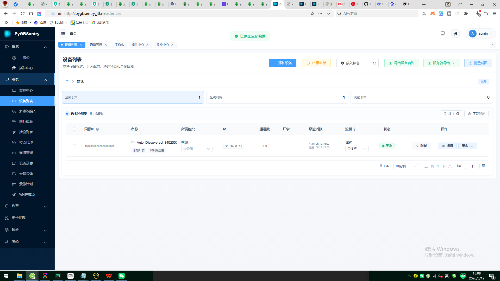
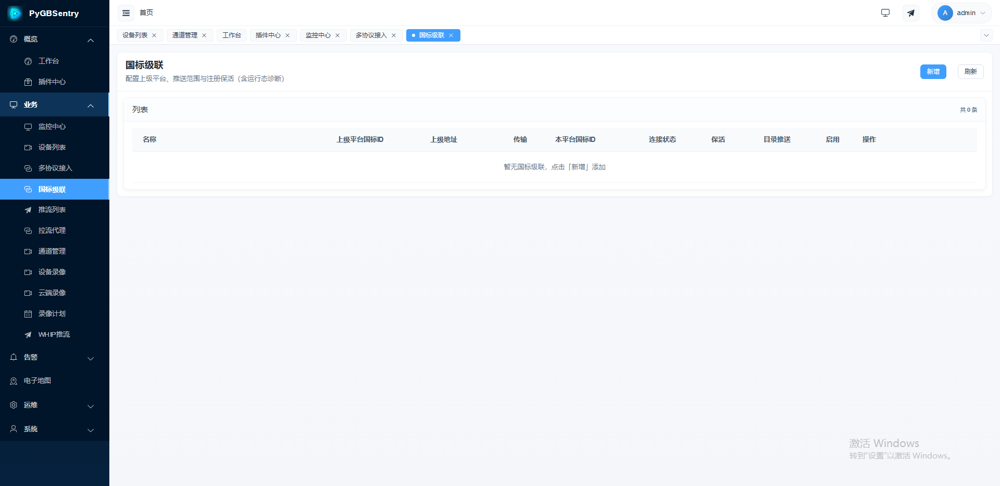
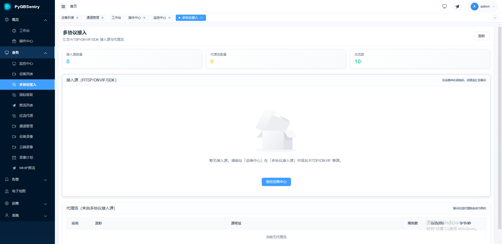

<div align="center">

  

# PyGBSentry

_开箱即用的国标（GB/T 28181-2022）视频管理平台 —— 纯 Python 自研 SIP 栈_

<p align="center">
  <strong>🇨🇳 中文</strong> ｜ <a href="README_EN.md">🇬🇧 English</a>
</p>

<p align="center">
  <a href="https://github.com/suoten/PyGBSentry/actions/workflows/ci.yml"></a>
  <a href="https://github.com/suoten/PyGBSentry/releases"></a>
  
  
  
  
  
  
</p>

<p align="center">
  <a href="https://github.com/suoten/PyGBSentry/stargazers"></a>
  <a href="https://gitee.com/suoten/PyGBSentry/stargazers"></a>
  <a href="https://github.com/suoten/PyGBSentry/issues"></a>
</p>

**[GitHub](https://github.com/suoten/PyGBSentry)** ｜ **[Gitee](https://gitee.com/suoten/PyGBSentry)**

</div>

---

> **🚀 想要一个秒级启动、纯 Python 原生、对 AI 生态友好的国标视频平台？**
> 就是它了。**生产环境需要 Go 单二进制部署、插件商城与企业级授权？请了解同一团队的商业版 [GBWatch](#-商业版-gbwatchgo)。**

## ⚡ 5 分钟零硬件体验（无需任何摄像头）

**前置要求**：一台装了 Docker 的电脑（Windows：Docker Desktop + Git Bash；Linux 自带）。**不需要摄像头、Python、Node**——预构建镜像由 CI 发布，首次启动约 3~5 分钟。

### 三步走

```bash
# 1. 克隆仓库
git clone https://github.com/suoten/PyGBSentry.git && cd PyGBSentry

# 2. 一键启动（自动拉取镜像、生成配置、等待就绪）
bash demo.sh

# 3. 浏览器打开 http://<本机IP>/
#    账号 admin；初始密码看 demo.sh 完成时的提示，或：
docker exec pygbsentry-backend-1 cat /app/data/.admin_initial_password
```

### demo.sh 自动完成的事

- 生成 `.env`：随机密钥 + 强口令（满足 prod 安全校验）+ 自动探测本机 IP
- 启动全栈：backend / frontend / PostgreSQL / Redis / ZLM 流媒体 / 设备模拟器
- 等待 backend 就绪 → 重启 zlm 重挂网络栈 → 自动把媒体节点 SDP IP 指向
  backend 容器（绕开 Docker Desktop UDP 回环丢包）→ 清理黑名单

### 完成后你会看到

- **设备列表**：2 台模拟 NVR（`34020000001310000001` / `34020000001310000002`）在线，各 2 通道
- **点播**：点击任意通道，约 3 秒内出测试卡画面（浏览器直接看 flv/hls）
- **运维中心**：部署体检、播放诊断、流量统计等页面全部可用

### 停止与清理

```bash
bash demo.sh --stop    # 停止服务（保留数据）
bash demo.sh --down    # 删除容器（保留数据卷）
```

> 点播无画面、设备离线等问题速查 [tools/device-simulator/README.md](tools/device-simulator/README.md)
> 的故障排查表；想自定义模拟设备数量/通道数等参数见下方 [🎬 设备模拟器](#-设备模拟器零硬件体验引擎) 章节。

**PyGBSentry** 基于**最新 GB/T 28181-2022 标准**构建（向下兼容 2016 版设备）。与依赖第三方 C 库或商业 SIP 中间件的方案不同，我们从零实现了**纯 Python 的 SIP/GB28181 协议栈**，让你真正掌控从信令到流媒体的全链路。

## 🎬 设备模拟器（零硬件体验引擎）

模拟器是仓库自带的 GB28181 终端仿真器（**纯 Python、零第三方依赖**），把"没有摄像头"
从体验障碍变成平台自身的演示与测试能力——销售演示、CI 协议回归、开发调试三合一。

### 协议能力清单

| 能力 | 实现要点 |
|------|---------|
| 注册与注销 | Digest 认证（qop=auth、SHA-256/MD5 自动跟随质询、cnonce 防重放） |
| 心跳保活 | Keepalive SN 单调递增（毫秒时间戳起步防回退） |
| 目录与查询 | Catalog / DeviceInfo / DeviceStatus / TimeSync 全响应，SumNum / DeviceList@Num 兼容分包 |
| 点播交互 | INVITE SDP 协商（y= SSRC 回显、f= 字段、TCP setup 主动/被动翻转） |
| 媒体推流 | RTP PS 流循环发送（UDP + RFC4571 TCP），SSRC / PT / marker 与 SDP 严格一致 |
| 挂断与会话 | BYE 响应、ACK 兜底发流、会话状态机完整清理 |

### 三种使用方式

| 方式 | 命令 | 场景 |
|------|------|------|
| ① 一键全栈 | `bash demo.sh` | 最快体验（自动生成 .env、自动配置 SDP IP、自动清黑名单） |
| ② compose overlay | `docker compose -f docker-compose.yml -f docker-compose.simulator.yml up -d` | 需要自定义 `.env` 参数时 |
| ③ 独立运行 | `python tools/device-simulator/device_simulator.py` | 不部署本平台，对接其他国标平台做兼容性测试 |

### 可调参数（.env，前缀 `SIM_`）

| 变量 | 默认值 | 说明 |
|------|--------|------|
| `SIM_DEVICE_COUNT` | 2 | 模拟设备数（NVR 台数） |
| `SIM_CHANNELS_PER_DEVICE` | 2 | 每台设备的通道数 |
| `SIM_DEVICE_PASSWORD` | 与 `SIP_DEFAULT_PASSWORD` 同步 | 设备接入密码 |
| `SIM_SERVER_ID` | 34020000002000000001 | 平台服务器 ID |
| `SIM_SIP_DOMAIN` | 3402000000 | SIP 域（默认取服务器 ID 前 10 位） |
| `SIM_PLATFORM_HOST` | backend | 平台地址（跨机部署改为宿主机 IP） |
| `SIM_KEEPALIVE_INTERVAL` | 60 | 心跳间隔（秒） |
| `SIM_MEDIA_FPS` / `SIM_MEDIA_SIZE` | 25 / 704x576 | 测试卡帧率与分辨率 |
| `SIM_MEDIA_DURATION` | 30 | 测试卡视频时长（秒，循环播放） |

### 自带协议回归测试

`python tools/device-simulator/local_e2e_test.py` —— 内置假平台独立验算注册/目录/
点播/收流四阶段，无需启动真实平台即可跑，可直接作为 CI 协议回归用例。

> 完整部署拓扑、Docker Desktop 踩坑记录与故障排查表见
> [tools/device-simulator/README.md](tools/device-simulator/README.md)。

## 🐳 免构建：直接拉取 Docker 镜像

发布 tag 后 CI 自动构建推送（`docker compose up -d` 会优先使用本地/拉取的镜像，仅缺失时才本地构建）：

```bash
docker pull ghcr.io/suoten/pygbsentry:latest            # backend
docker pull ghcr.io/suoten/pygbsentry-frontend:latest   # frontend（nginx + 静态资源）
```

国内网络可用 daocloud 代理直接拉取（拉取即缓存）：

```bash
docker pull ghcr.m.daocloud.io/suoten/pygbsentry:latest
docker pull ghcr.m.daocloud.io/suoten/pygbsentry-frontend:latest
```

> **想要专属国内源？** 配置阿里云 ACR（免费个人版）后，每次发版 CI 自动同步镜像，
> 一次配置永久生效——步骤见 [docs/ALIYUN_ACR_SETUP.md](docs/ALIYUN_ACR_SETUP.md)。

---

## ✨ 为什么选择 PyGBSentry？

| 维度 | PyGBSentry | 传统方案 |
|------|-----------|---------|
| ⚡ 启动速度 | **秒级** | 分钟级 |
| 🛠️ 开发效率 | **Python 生态** | 复杂配置 |
| 🤖 AI 集成 | **原生友好** | 需要额外适配 |
| 🔄 并发模型 | **异步架构** | 线程模型 |

Python + FastAPI 意味着**秒级启动**、**原生异步并发**和**开箱即用的 AI 生态**。不用和 XML 缠斗，没有不透明的二进制——只有干净、可读的 Python。

---

## 🎯 核心特性

### ⚡ 首帧 < 500ms

RTP 端口池预分配 + 四路并行 INVITE + RTT 自适应定时器，交付你在 GB28181 平台上见过的最快实况连接。

### 🩺 六维健康评分 + 播放自愈

六大维度实时健康评分，智能播放恢复：

- **RTCP NACK** —— 丢包瞬时重传
- **UDP → TCP 自动降级** —— 网络劣化时无缝切换传输协议
- **双缓冲无缝切换** —— 零花屏的流切换

### 🔍 纯 Python SIP 栈 —— 没有黑盒

每一条 SIP 消息都用纯 Python 解析、构造与分发。完全透明、完全可调试、完全属于你。在信令流程的任意位置打下断点，看清正在发生的一切。

### 📡 GB/T 28181-2022 原生支持

全面符合最新国标：

- `a=track` SDP 协商
- 绝对云台定位
- 3D 拉框放大（DragZoom）
- 设备文件目录检索

### 🧩 插件生态

无需 Fork 即可扩展：

- **飞书** —— 告警通知
- **企业微信** —— 企业消息
- **MQTT** —— 物联网桥接
- **S3** —— 云端归档
- **AI** —— 推理管线集成

### 🏎️ 高并发优化

| 优化项 | 效果 |
|-------|------|
| 分片 DialogManager | 会话分片，锁竞争降低 16 倍 |
| 对象池 | 2K+ 对象预分配，热路径零 GC 压力 |
| 线程池 | SIP 消息多核并行解析 |
| 预过滤 Handler | 分发前减少 70% 无效消息扫描 |

### 🏗️ 生产级高可用

- **RFC 3261 状态机** —— 标准兼容的 SIP 会话生命周期
- **Redis 持久化** —— 会话状态重启不丢
- **节点故障转移** —— 多节点部署自动恢复
- **TLS 热重载** —— 证书轮换不停机
- **后台任务全接线** —— 录制看门狗、空闲流回收、拉流代理自愈、幽灵流对账等 22 个周期任务由统一任务管理器调度，故障自愈不靠人盯

### 🩺 播放自诊断 + 部署体检

把"收流超时为什么发生"变成"平台直接告诉你答案"：

- **播放失败一键诊断** —— 点播失败时逐关卡检查（设备注册 / 信令地址 / 设备可达 / 流媒体节点 / 公网地址 / SSRC 余量），每项给出结论与修复指引
- **部署体检** —— 运维中心一键体检：SIP、数据库、Redis、流媒体节点（含 secret 匹配）、对外地址、收流配置、安全基线、后台任务、资源占用
- **录制看门狗** —— 定时录像周期性校验 ZLM 真实录制状态，中断自动重启，不再静默丢录像

### 🔗 集成友好：分享嵌入 + API 契约

- **一键分享/嵌入** —— 播放对话框点一下，生成带 HMAC 签名令牌的嵌入页 URL 与 iframe 代码（1 小时～7 天有效期），第三方页面直接嵌入，管理页安全防护不受影响
- **厂商自动探测** —— 对讲兼容无需按厂商手工配置：平台自动学习每台设备对标准流程的支持（大华 MESSAGE 先行 / 海康直连 INVITE 自动适配）
- **API 契约（只增不减）** —— `/api/v1` 全量端点快照进入 CI，删除已发布端点或变更方法会直接构建失败；集成者升级零惊喜
- **多租户内置** —— 不同账号看不同设备，租户级数据隔离 + 通道配额，企业共享部署开箱即用

---

## 📸 界面预览

<table>
  <tr>
    <td align="center"><b>监控中心（多分屏实时预览）</b></td>
    <td align="center"><b>工作台（资源概览与告警趋势）</b></td>
  </tr>
  <tr>
    <td></td>
    <td></td>
  </tr>
  <tr>
    <td align="center"><b>通道工作区（设备通道管理 / 云台 / 预览）</b></td>
    <td align="center"><b>设备列表（国标设备台账）</b></td>
  </tr>
  <tr>
    <td></td>
    <td></td>
  </tr>
  <tr>
    <td align="center"><b>国标级联（上下级平台对接）</b></td>
    <td align="center"><b>多协议接入（RTSP / ONVIF / SDK）</b></td>
  </tr>
  <tr>
    <td></td>
    <td></td>
  </tr>
</table>

> 更多界面截图见 [docs/images/](docs/images/)。

------

## 🏛️ 技术架构

```
┌─────────────────────────────────────────────────────────────────────┐
│                        终端层（多端覆盖）                              │
│   ┌──────────────┐  ┌──────────────┐  ┌──────────────────────────┐  │
│   │   Web 后台    │  │  Mobile App  │  │    第三方平台 / 设备      │  │
│   │  Vue 3 + TS  │  │  uni-app     │  │    GB28181 级联对接       │  │
│   └──────┬───────┘  └──────┬───────┘  └────────────┬─────────────┘  │
└──────────┼─────────────────┼───────────────────────┼────────────────┘
           │                 │                       │
┌──────────▼─────────────────▼───────────────────────▼────────────────┐
│                        接入网关层                                     │
│              Nginx 负载均衡 / HTTPS 终结 / 静态资源分发                  │
└──────────────────────────┬──────────────────────────────────────────┘
                           │
┌──────────────────────────▼──────────────────────────────────────────┐
│                        业务服务层（FastAPI）                           │
│   REST API · WebSocket 推送 · 插件运行时 · 审计日志 · 配置治理            │
├──────────────────────────┬──────────────────────────────────────────┤
│       SIP 信令引擎        │           流媒体网关                      │
│   自研 Python SIP 栈      │      ZLMediaKit Hook 对接                 │
│   GB28181 注册/点播/回放   │   WebRTC / FLV / HLS / RTSP / RTMP       │
│   级联/PTZ/报警/语音      │   RTP 接收 / 录像回调 / 云端录制            │
├──────────────────────────┴──────────────────────────────────────────┤
│                        数据与缓存层                                    │
│   PostgreSQL / MySQL / SQLite            │         Redis              │
│   （持久化数据、审计日志、级联关系）          │    （会话、状态、限流）       │
└─────────────────────────────────────────────────────────────────────┘
```

---

## 🚀 快速开始

### 先选一条适合你的安装路线

| 你的情况 | 推荐路线 | 需要预装 | 耗时 |
|---|---|---|---|
| Windows 个人体验，**什么都不想装** | ① 安装向导 exe | 无 | 5~10 分钟 |
| Windows，已装 Python 3.11+ | ② 一键脚本 `install.bat` | Python 3.11~3.13 | 3~5 分钟 |
| Linux 服务器快速体验 | ② 一键脚本 `install.sh`（SQLite 模式） | Python 3.11~3.13 | 3~5 分钟 |
| Linux 生产环境（真实摄像头、长期运行） | ③ Docker（含流媒体 ZLMediaKit） | Docker | 10 分钟 |
| 给客户/内网交付，目标机不能联网 | ④ Windows 便携版 zip | 无 | 解压即用 |

> 四条路线装出来的是**同一个平台**：启动后浏览器打开 `http://localhost:端口` 就是完整管理界面
> （后端直接托管网页，无需单独部署前端）。管理员账号 `admin`。

---

### 路线 ①：安装向导 exe（Windows 小白首选，连 Python 都不用自己装）

1. 到 [Gitee Releases](https://gitee.com/suoten/PyGBSentry/releases) 下载 `PyGBSentrySetup.exe`
2. 双击运行——若 Windows SmartScreen 提示"未识别应用"，点「更多信息」→「仍要运行」
3. 点「开始安装」，然后等。向导全自动完成：
   - 检测并静默安装 Python 3.12（你什么都不用点）
   - 下载源码（约 200~300MB）→ 创建虚拟环境 → 安装依赖 → 初始化数据库
   - 生成随机管理员密码，保存到安装目录的 `ADMIN_PASSWORD.txt`
   - 创建桌面快捷方式「PyGBSentry」，并自动打开浏览器
4. 登录：账号 `admin`，密码打开 `ADMIN_PASSWORD.txt` 抄（登录后请修改）

日常使用：桌面「PyGBSentry」= 启动；安装目录「停止PyGBSentry.bat」= 停止。

---

### 路线 ②：一键脚本安装（Windows 双击 / Linux 一行命令）

#### 第 1 步：安装 Python 3.12（唯一需要手动装的东西）

- Windows：到 [python.org/downloads](https://www.python.org/downloads/release/python-3128/) 下载安装，
  **安装第一屏务必勾选 `Add python.exe to PATH`**（国内镜像：[华为云](https://mirrors.huaweicloud.com/python/)）
- Ubuntu/Debian：`sudo apt update && sudo apt install -y python3.12 python3.12-venv`
- CentOS/RHEL：`sudo dnf install -y python3.12`
- macOS：`brew install python@3.12`

装完验证：打开新终端输入 `python --version`（或 `python3 --version`），显示 `3.11` ~ `3.13` 即可。

> ⚠️ Python 3.8 / 3.9 / 3.10 无法运行本项目（会报语法错误），脚本检测到会给出以上下载指引。

#### 第 2 步：获取代码

- 会用 Git：`git clone https://gitee.com/suoten/PyGBSentry.git`，然后 `cd PyGBSentry`
- 不会 Git：打开 https://gitee.com/suoten/PyGBSentry → 点「克隆/下载」→「下载 ZIP」→ 解压后进入 `PyGBSentry-master` 文件夹

#### 第 3 步：一键安装

- **Windows**：进入解压出来的 `PyGBSentry` 文件夹（代码根目录，`install.bat` 就在里面），**双击 `install.bat`**，等它跑完（约 3 分钟）
- **Linux / macOS**：`bash install.sh`（国内下载慢加 `--mirror` 参数），等它跑完

脚本会询问管理员密码（直接回车 = 自动生成），并保存到 `ADMIN_PASSWORD.txt`，记下来。

#### 第 4 步：启动

- **Windows**：双击 `start.bat`——浏览器会自动打开平台页面（窗口别关，关了服务就停）
- **Linux / macOS**：`./start.sh`

#### 第 5 步：登录使用

浏览器打开 **http://localhost:8000**（端口被占用时安装脚本会自动换并提示），
账号 `admin`，密码为安装时设置的密码。

#### 常见问题（路线 ②）

| 现象 | 解法 |
|---|---|
| 提示 Python 版本不对 / SyntaxError | Python 3.8/3.9/3.10 不行。按第 1 步装 3.12，**重开终端**再试 |
| `python: command not found` | 用 `python3` 命令，或把 Python 加入 PATH 后重开终端 |
| 8000 端口被占用 | 安装脚本会自动换 8010/8080 等空闲端口；也可手动改 `backend/.env` 的 `BACKEND_PUBLIC_PORT` |
| pip 下载超时 | `bash install.sh --mirror`（Windows 的 install.bat 已内置清华镜像+自动回退） |
| 双击 install.bat 一闪而过 | 用 cmd 进入目录后输入 `install.bat` 运行，能看到具体报错 |
| 登录密码不对 | 密码在 `backend/.env` 的 `ADMIN_INITIAL_PASSWORD`；改成你想要的值后删除 `backend/data/gb_sentry.db*` 再跑一遍安装脚本即重置 |
| 忘了服务怎么停 | 双击 `stop.bat`（Linux：`./stop.sh`） |
| 怎么卸载 | 停止服务后直接删除整个文件夹即可（SQLite 模式无残留） |

---

### 日常运维三件套（路线 ①② 通用）

| 脚本 | 作用 |
|---|---|
| `stop.bat` / `stop.sh` | 停止服务 |
| `update.bat` / `update.sh` | 一键更新（git pull + 刷新依赖 + 数据库同步） |
| `doctor.bat` | 环境自检报告——提 issue 时把输出贴上来，秒定位 |

> 启动日志显示 `SIP bind failed / 5062 被占用`：平台仍可正常使用（仅设备注册暂不可用），
> 先 stop 再 start；接真实摄像头前需解决。

### 路线 ③：Docker 一键部署（Linux 生产推荐，含流媒体服务）

```bash
git clone https://github.com/suoten/PyGBSentry.git
cd PyGBSentry

# 方式一：自动生成密钥并启动（推荐）
python tools/generate_env.py --docker
docker compose up -d

# 方式二：一行命令全自动部署
make docker-init
```

> **内置 ZLMediaKit 仅提供 Linux 二进制**。Windows / macOS 开发者请使用下方「本地开发模式」。

访问 `http://<服务器IP>` 进入安装向导，首次使用创建管理员账号即可。

> 🔍 部署诊断：`./deploy/setup.sh doctor` 一键检查端口、数据库、ZLM、SIP 服务状态。


### 路线 ④：Windows 便携版 zip（给客户/内网交付，目标机零环境）

在本机（有 Python 的机器）一条命令制作分发包：

```bash
python make_portable.py --mirror
# 产出 dist_portable/PyGBSentry-windows-portable.zip（约 280MB）
```

把这个 zip 发给任何人：**解压到任意目录 → 双击「启动PyGBSentry.bat」→ 浏览器自动打开完整平台**。
内置嵌入式 Python 与全部依赖，目标机器不需要装任何东西；
管理员密码见包内 `ADMIN_PASSWORD.txt`。制作与分发详见 `packaging/windows/README.md`。

---

### 装好后做什么（所有路线通用）

- **登录平台**：浏览器打开平台地址，账号 `admin`（密码见各路线说明），首次登录后请修改
- **安装插件**（告警推送、AI 分析等 14 个）：平台左侧「插件中心」→ 登录官网账户 → 一键安装
- **接入真实摄像头**：需要流媒体服务——路线 ③ 的 Docker 镜像已内置；其余路线看
  [docs/INSTALL.md](docs/INSTALL.md)（关键词 ZLMediaKit）
- **改端口**：`backend/.env` 的 `BACKEND_PUBLIC_PORT`，改完重启
- **日常运维**：安装目录内有 `stop`（停止）、`update`（一键更新）、`doctor`（环境自检报告）脚本

### 本地开发模式（Windows / Linux / macOS）

```bash
cd backend
cp .env.example .env
python -m venv venv
# Windows: venv\Scripts\activate   Linux/macOS: source venv/bin/activate
pip install -r requirements.txt
python app/initial_data.py
python -m app.main          # → http://localhost:8000

cd ../frontend
npm install
npm run dev                 # → http://localhost:5173
```

本地模式使用 SQLite，无需 PostgreSQL/Redis，适合二次开发与轻量体验。

> 📖 完整部署手册（含生产环境 checklist、NAT、SSL、高可用）见 [docs/INSTALL.md](docs/INSTALL.md)。

---

## 🗂️ 功能全景

```
国标接入          视频业务          智能运维          数据集成          可视化
─────────────    ─────────────    ─────────────    ─────────────    ─────────────
设备注册          实时预览          网络看门狗        MQTT 对接        GIS 地图
平台级联(增量同步)  多分屏播放        流健康监测        Webhook 回调     电视墙
目录推送(经纬度)   录像检索回放       SLA 质量看板      级联上报         轨迹回放
GPS 订阅          预置位轮巡(级联)   播放自诊断        飞书/企微告警     可视化指挥
语音对讲(自动适配)  录像计划(看门狗)   部署体检          S3 云存储        告警联动
租户隔离          分享/嵌入播放      API 契约(CI)      插件生态         流量报表
```

---

## 💎 商业版：GBWatch（Go 语言）

同一团队打造的**商业版视频平台**，与 PyGBSentry 定位互补、代码库独立：

| | PyGBSentry（本项目） | GBWatch（商业版） |
|---|---|---|
| 语言 | Python 3.12+ / FastAPI | Go 1.25+（单二进制） |
| 许可 | AGPL v3（开源） | 商业许可（闭源二进制交付） |
| 定位 | 开发者 / AI 生态 / 二次开发 | 生产环境交付 / 商业运营 |
| 插件生态 | Python 插件 | 插件商城（官方 + 第三方，付费订阅） |
| 平台授权 | — | 按通道数授权（64 / 256 / 不限），Ed25519 实例绑定证书，超限拒绝新增设备 |
| 插件商城支付 | — | 支付宝 / 微信扫码购买插件，管理后台一键配置 |

GBWatch **覆盖开源版的全部核心能力**（设备注册/目录/实时预览/录像回放/云台/级联/告警等），并在此基础上额外提供：

| 增量能力 | 说明 |
|---------|------|
| 🚀 部署形态 | Go 单二进制 + 一键脚本，**3 分钟上线**；前端内嵌、内置 SQLite，无需 Nginx / MySQL / 编译环境（开源版为 Python + Docker/源码部署） |
| 📹 全协议矩阵 | GB/T 28181-2016/2022 双向级联（含目录订阅与 TCP 主动收流）· ONVIF Profile S 自动发现 · JT/T 808+1078 车载视频×轨迹同步 · GA/T 1400 视图库上报 · 海康 ISAPI / 大华 HTTP 事件网关 · RTSP/RTMP 拉流代理 |
| 🤖 AI 闭环 | 定时抓拍 → 推理服务 → 结构化事件 → 告警联动 → **以图搜图**（切片归并），内置周界防护 / 工地安全 / 移动侦测算法包 |
| 🔔 告警体系 | 30+ 报警类型**中文解析**；飞书 / 钉钉 / 企微 / 邮件 / 短信 / MQTT 推送；未处理自动升级链 L1→L2→L3 · 值班路由 · 声光/门禁/广播联动 · 报警切片 HMAC 签名免登分享 |
| 🏢 企业级 | 多租户行级隔离 + 配额 · License 功能矩阵 + 机器码绑定 · 取证证据链（SHA-256 链式哈希）· 审计中心 · 设备远程配置回显+下发（OSD/录像计划/升级等）· MinIO / NAS 归档 |
| 📦 插件商城 | **36 个官方插件**开箱即用（AI 分析 10 / 告警推送联动 9 / 运维巡检 11 / 存储证据 3 / 安全网络 3），子进程 Hook 模型任何语言可写，第三方实名入驻、支付宝/微信扫码购买 |
| ✅ 质量保障 | 六套端到端验收套件（70+ 断言）一键复跑，覆盖级联、通道授权、取证、推送等核心链路 |

**交付形态**：闭源二进制交付，License 与部署实例 Ed25519 绑定、防篡改，禁止逆向与二次分发；同一团队提供部署、定制与技术支持服务。

### 授权版本与定价

| 版本 | 通道数 | 定价 | 目标客户 |
| --- | --- | --- | --- |
| 标准版 | 64 路 | ¥5,800 永久授权（含首年更新与工单） | 小型项目、单体企业（几十路摄像头） |
| 专业版 | 256 路 | ¥19,800 永久授权（含首年更新与插件商城） | 中型项目、需要 AI 插件与商城生态 |
| 旗舰版 / OEM | 不限 | ¥59,800 / 年（含年度续约与优先支持） | 集成商批量交付、OEM 白标贴牌 |

> 所有版本均为**闭源二进制交付**，授权证书与部署实例绑定（Ed25519 防篡改），超出通道数自动拒绝新增设备；更新服务续费为授权费的 20%/年。价格可随项目规模与 OEM 数量另议。

PyGBSentry 与 GBWatch 服务于不同场景：**学习、二次开发、AI 集成选 PyGBSentry；生产部署、商业运营、需要插件生态与支付能力选 GBWatch。**

<a href="#-商业版-gbwatchgo"></a>

---

## 📡 GB/T 28181-2022 增强特性

| 2022 新特性 | 说明 | 配置方式 |
|:---|:---|:---|
| **SDP a=track 轨道标识** | 精准区分主/子码流与多路轨道，解决 2016 版码流切换模糊问题 | `GB28181_STREAM_SWITCH_USE_TRACK_SUBJECT=true` |
| **绝对云台控制** | 支持地理坐标级精准定位，满足高空瞭望、应急指挥场景 | API 自动识别 2022 指令 |
| **3D 放大/定位 (DragZoom)** | 框选即放大，操作体验对标主流 GIS 平台 | PTZ 面板直接调用 |
| **文件目录检索** | 按时间、类型、通道精准检索设备端录像文件 | `/api/v1/devices/{id}/file-catalog` |
| **报警细化分类** | 支持入侵、徘徊、聚集等 20+ 细分报警类型订阅与联动 | 报警中心自动解析 |
| **远程配置下载/设置** | 批量下发编码、网络、OSD 参数，千级设备集中运维 | ConfigDownload / ConfigSet API |

> **如何切换版本**：修改 `backend/.env` 中的 `GB28181_VERSION=2022`，重启后端即可。系统会自动适配 SDP、信令 XML 与交互流程。

---

## 💻 系统要求

| 部署形态 | 操作系统 | 内存 | 说明 |
|:---|:---|:---|:---|
| Docker 完整部署 | Linux（Ubuntu 20.04+ / Debian 11+ / CentOS 8+） | 4GB+ | 含 ZLMediaKit 流媒体服务，推荐生产环境 |
| 本地开发模式 | Linux / Windows 10+ / macOS 12+ | 2GB+ | SQLite 开箱即用，需外置 ZLM 才能播放 |
| 高可用集群 | Kubernetes 1.25+ | 8GB+ | 使用 `deploy/helm/` 部署 |

详细环境要求与端口说明请参考 [docs/INSTALL.md](docs/INSTALL.md)。

---

## 📖 文档导航

| 文档 | 适合谁 | 内容 |
|:---|:---|:---|
| [INSTALL.md](docs/INSTALL.md) | 运维/实施 | 完整部署手册，含 Docker、手工、高可用方案 |
| [INSTALL_DEPLOY.md](docs/INSTALL_DEPLOY.md) | 运维/实施 | 生产环境 checklist、NAT、端口、SSL 配置 |
| [DEVELOPER.md](docs/DEVELOPER.md) | 开发者 | 架构详解、目录说明、添加 API、扩展 SIP 逻辑 |
| [PLUGIN_SPEC.md](docs/PLUGIN_SPEC.md) | 开发者 | 插件开发规范、生命周期、API、上架流程 |
| [MEDIA_SERVER.md](docs/MEDIA_SERVER.md) | 运维/开发者 | ZLMediaKit 配置、Hook 说明、排错指南 |
| [COMPATIBILITY.md](docs/COMPATIBILITY.md) | 实施/用户 | 浏览器与设备兼容性矩阵、厂商特性开关 |
| [TENANCY.md](docs/TENANCY.md) | 实施/用户 | 多租户模型、角色体系、多部门/代理商场景指南 |
| [API_CONTRACT.md](docs/API_CONTRACT.md) | 集成开发者 | API 兼容性口径、CI 契约机制、破坏性变更流程 |
| [ROADMAP.md](docs/ROADMAP.md) | 所有人 | 产品路线图（基于同类平台社区反馈的需求分析） |
| [QA_TROUBLESHOOT.md](docs/QA_TROUBLESHOOT.md) | 所有人 | 常见问题与排查步骤 |
| [ALIYUN_ACR_SETUP.md](docs/ALIYUN_ACR_SETUP.md) | 维护者 | 国内镜像源（阿里云 ACR）一次配置永久自动同步 |
| [设备模拟器](tools/device-simulator/README.md) | 测试/演示 | 零硬件体验引擎：模拟 NVR 注册/点播/收流，环境变量与排查表 |

---

## 🤝 参与贡献

欢迎任何形式的贡献：Issue 反馈、文档改进、功能开发、Bug 修复。

```bash
# 1. Fork 本仓库
# 2. 创建特性分支
git checkout -b feature/your-feature
# 3. 提交变更
git commit -m "feat: add your feature"
# 4. 推送并发起 Pull Request
git push origin feature/your-feature
```

---

## 🔗 关联项目

**🩺 GBDoctor — GB/T 28181 接入诊断医生**

与 PyGBSentry 互为补充：**PyGBSentry** 负责把设备"接上来、管得好"，**GBDoctor** 负责在接不上、画面有问题时快速定位"为什么"——同时扮演模拟上级平台和模拟摄像头两个角色，3 分钟输出全链路（注册/保活/目录/点播/云台等 12 项）体检报告，无需抓包。

- **Gitee**：[gitee.com/suoten/GBDoctor](https://gitee.com/suoten/GBDoctor)
- **GitHub**：[github.com/suoten/GBDoctor](https://github.com/suoten/GBDoctor)

平台接入不顺畅？用 GBDoctor 体检一下就知道卡在哪一环。

**🧰 更多相关项目**

| 项目 | 简介 | 仓库 |
|------|------|------|
| **ProtoForge** | 开源 PLC 协议模拟器：零硬件模拟 Modbus/S7/OPC-UA/BACnet/GB28181 等 28 种协议，测试上位机与网关通信 | [Gitee](https://gitee.com/suoten/ProtoForge) · [GitHub](https://github.com/suoten/ProtoForge) |
| **EdgeLiteGateway** | 开源边缘 AI 网关（Python 版）：13 种工业协议 + ONNX 推理引擎，10 分钟 Docker 部署 | [Gitee](https://gitee.com/suoten/EdgeLiteGateway) · [GitHub](https://github.com/suoten/EdgeLiteGateway) |
| **EdgeLiteGateway-Go** | 工业边缘 AI 网关 Go 版：单二进制部署，附 Linux amd64/arm64/armv7 预编译包 | [Gitee](https://gitee.com/suoten/EdgeLiteGateway-Go) · [GitHub](https://github.com/suoten/EdgeLiteGateway-Go) |
| **EdgeAgent-Hub** | 边缘智能体管理平台（Go）：ONNX + LLM + RAG + 多智能体编排，Modbus/OPC UA/MQTT 全协议接入，断网自治 + A/B 分区 OTA | [Gitee](https://gitee.com/suoten/edgeagent-hub) · [GitHub](https://github.com/suoten/EdgeAgent-Hub) |
| **IoT-ZTNA** | IoT 零信任网络访问网关（Rust）：eBPF/XDP 线速过滤 + SPIFFE 设备身份 + AI 行为检测 | [Gitee](https://gitee.com/suoten/iot-ztna) · [GitHub](https://github.com/suoten/IoT-ZTNA) |

---

## 📄 开源协议

本项目采用 [GNU Affero General Public License v3.0](LICENSE) 开源协议。

> 对于网络交互软件，AGPL v3 确保任何在公网提供服务的修改版本，也必须向用户公开源代码。这保护了开源社区的利益，也保证了项目的长期健康发展。

---

## ⭐ 社区与支持

- 问题反馈：[GitHub Issues](https://github.com/suoten/PyGBSentry/issues) ｜ [Gitee Issues](https://gitee.com/suoten/PyGBSentry/issues)
- **QQ 交流群**：`928800460`（部署疑难、级联对接、厂商兼容问题直接问，作者在线）
- 作者邮箱：[suoten@163.com](mailto:suoten@163.com)
- 商业支持（部署实施 / 级联对接 / 定制开发）：见 [商业支持](#商业支持与定制服务)

如果你觉得项目有帮助，欢迎点亮 **Star**，这是对开源作者最好的鼓励。

---

<div align="center">

# English

**Turn any server into a GB/T 28181-compliant intelligent video hub — pure Python SIP stack, built from scratch.**

📖 **[English Documentation → README_EN.md](README_EN.md)**

PyGBSentry is an open-source video management platform built on **GB/T 28181-2022** (backward compatible with 2016 devices), featuring a self-implemented pure Python SIP stack, FastAPI backend, Vue 3 admin UI, and integrated ZLMediaKit streaming — covering device access, platform cascading, live preview, playback, PTZ control, two-way audio, alarm linkage, and a plugin ecosystem.

</div>
